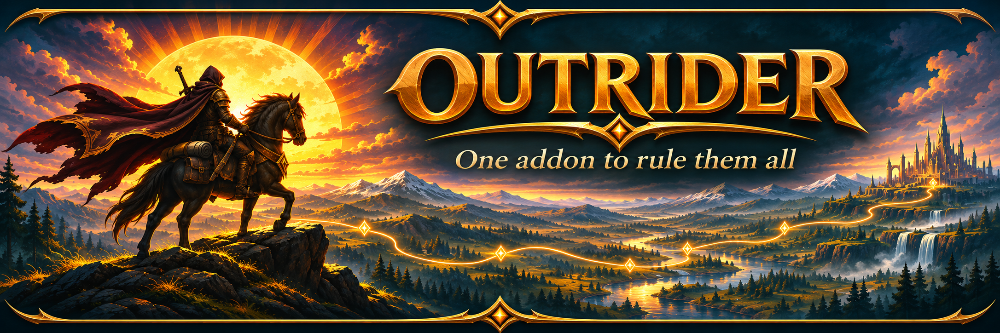

# Outrider: one addon for WoW Forever

One character-aware addon for World of Warcraft Forever instead of ten. It knows which character you're on (class, race, level, professions, gold) and shows only what applies to that character. It works on its own: no Questie, TomTom, Auctionator or TSM needed (if they're installed, Outrider uses their data or steps aside).

Created by **Gary Mix** and developed with AI-assisted coding tools. Tested by Gary in game. Every action in the game is a key press or click by the player; Outrider never plays for you.

**What it does:** see the [user guide](docs/USER_GUIDE.md) (also in game: `/ride`, then **Help**).

**[Join us on Discord](https://discord.gg/NqsBsDPqy):** talk with other Outrider players, report bugs, ask for features and hear about new versions first.

## Install (players)

Pick one. Each puts the same addon folders into `World of Warcraft\_forever_\Interface\AddOns`.

1. **CurseForge app or WowUp** (easiest, updates with one click): search **Outrider** and click Install. Coming once the CurseForge project is approved; steps and status in [docs/CURSEFORGE.md](docs/CURSEFORGE.md). WowUp lists WoW Forever as a supported client; in the CurseForge app, add your `World of Warcraft` folder by hand if it doesn't find Forever.
2. **One-click installer (Windows):** close World of Warcraft, download **Install-Outrider.cmd** from the [newest release](https://github.com/LackOfSkillz/outrider-releases/releases/latest) and double-click it. It finds WoW Forever, backs up an older Outrider and installs it with all its data (if Windows warns, click **More info**, then **Run anyway**). Updates: double-click **Update Outrider** on your desktop (WoW closed).
3. **By hand:** download the zip, unzip it straight into `_forever_\Interface\AddOns` so you get `AddOns\Outrider`, `AddOns\Outrider_Data_Quests` and so on (not `AddOns\Outrider-0.3.0\Outrider`).

Then start the game, log in and type `/ride`. In game, Outrider tells you when your build is two weeks old or another Outrider user has a newer one.

The one-click installer also brings Gary's shared world knowledge (NPCs met, places, gathering spots, rare sightings, prices). It's merged once and never overwrites what you've collected. It holds no character names, gold or logs.

## Screenshots

<table>
<tr>
<td width="50%" valign="top"><a href="docs/screenshots/home.png">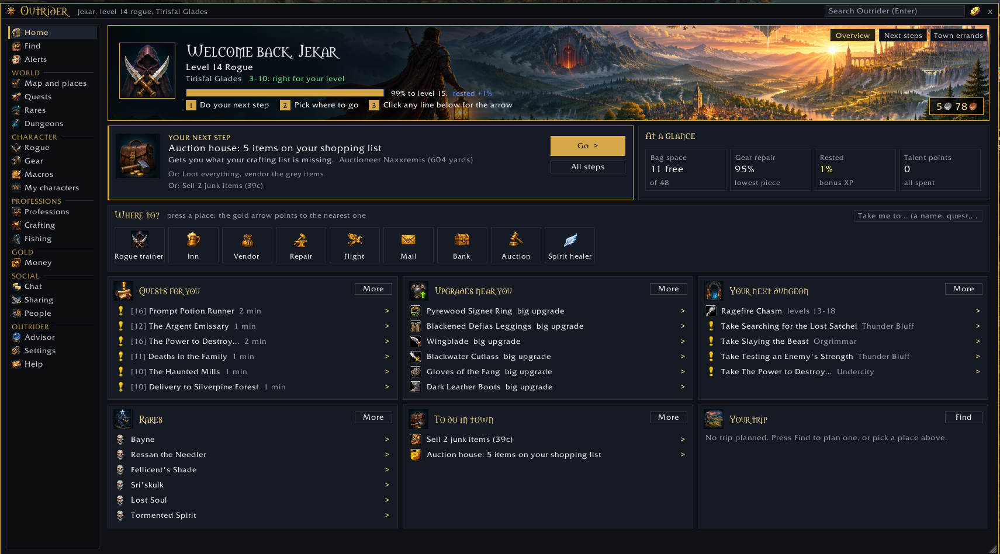</a> <b>Home</b>: Your next step, where to go, XP and rested, and six cards of quests, upgrades, dungeons, rares and errands.</td>
<td width="50%" valign="top"><a href="docs/screenshots/find.png">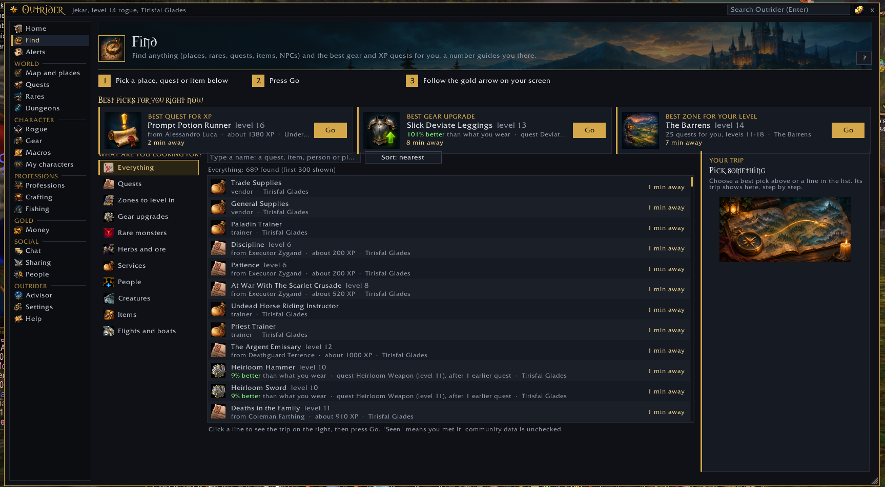</a> <b>Find</b>: Search anything; best quest, gear upgrade and zone for your level, one Go away.</td>
</tr>
<tr>
<td width="50%" valign="top"><a href="docs/screenshots/quests.png">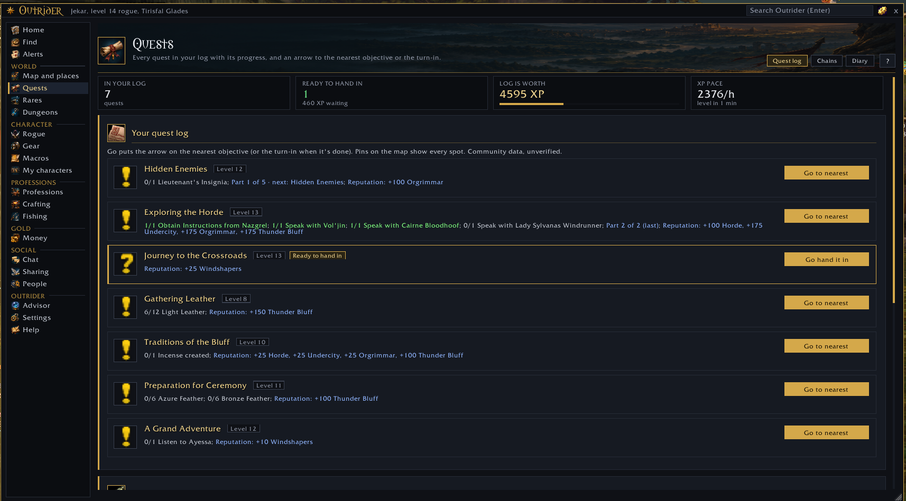</a> <b>Quests</b>: Every quest with its progress, reputation and an arrow to the nearest objective or turn-in.</td>
<td width="50%" valign="top"><a href="docs/screenshots/dungeons.png">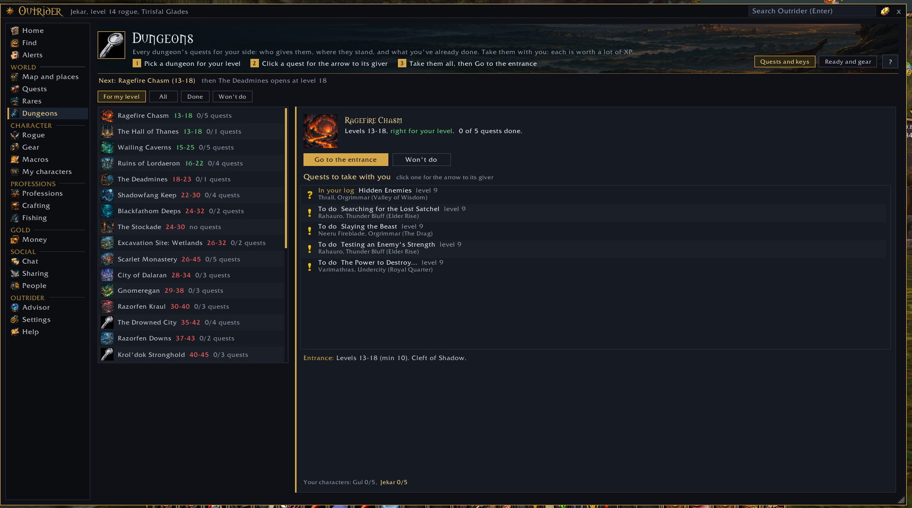</a> <b>Dungeons</b>: Which dungeons fit your level, the quests to take along and who gives them.</td>
</tr>
<tr>
<td width="50%" valign="top"><a href="docs/screenshots/rares.png">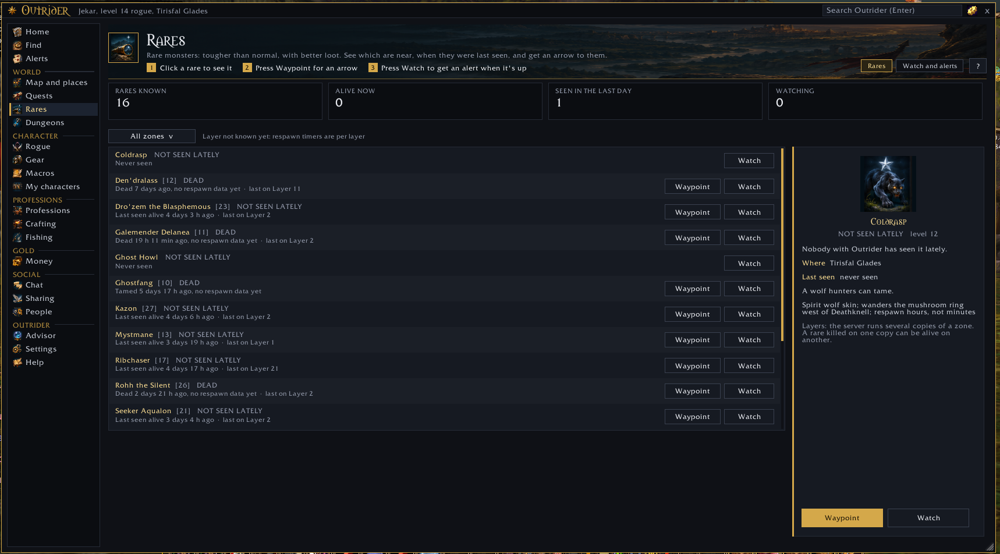</a> <b>Rares</b>: Rare monsters near you, when they were last seen and on which layer, with a waypoint.</td>
<td width="50%" valign="top"><a href="docs/screenshots/map-and-places.png">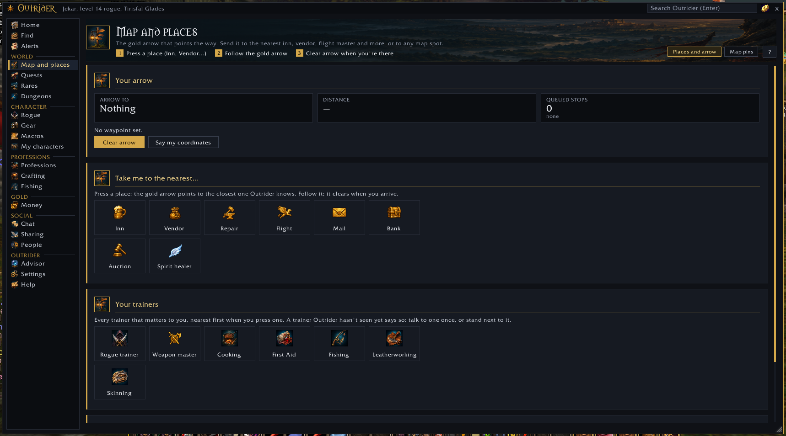</a> <b>Map and places</b>: The gold arrow to the nearest inn, vendor, flight master or any of your trainers.</td>
</tr>
<tr>
<td width="50%" valign="top"><a href="docs/screenshots/class.png">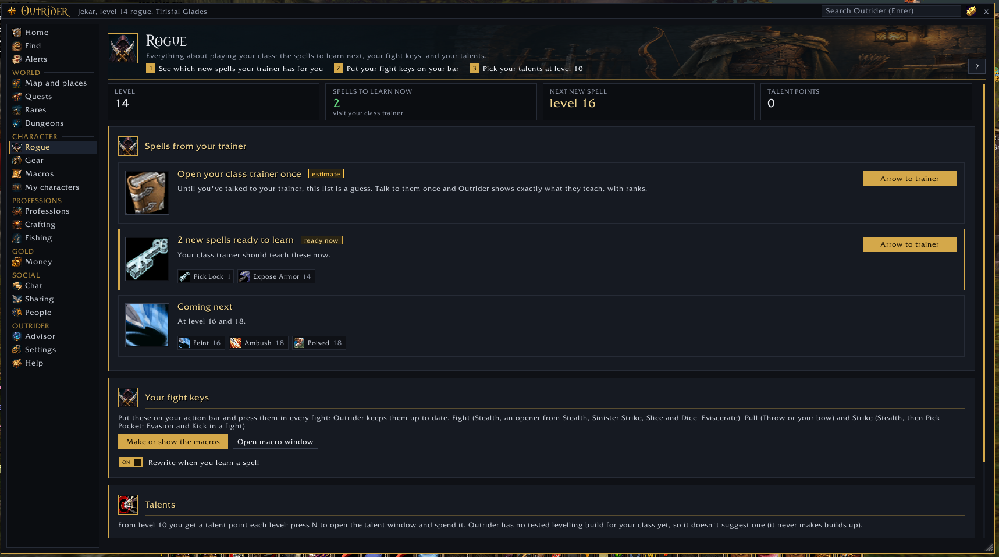</a> <b>Your class</b>: Spells your trainer has for you now and next, and fight keys written from your spellbook.</td>
<td width="50%" valign="top"><a href="docs/screenshots/macros.png">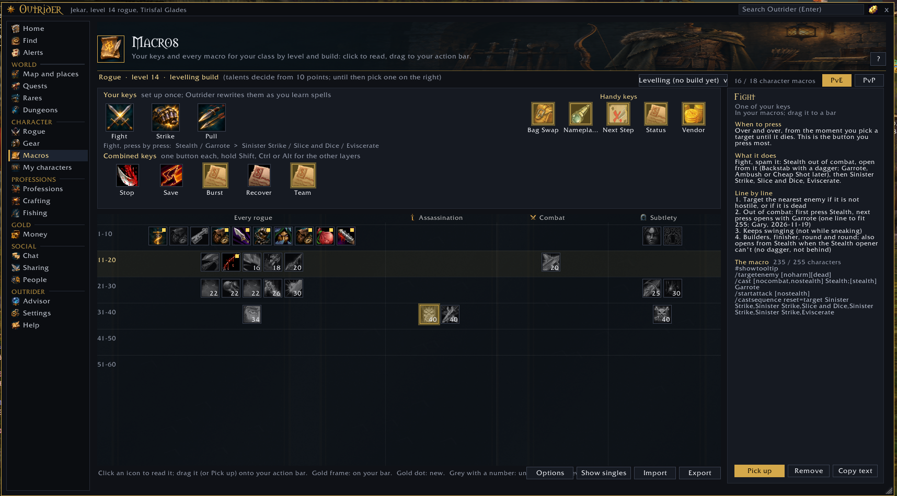</a> <b>Macros</b>: Every macro for your class by level and build, explained line by line, drag to your bar.</td>
</tr>
<tr>
<td width="50%" valign="top"><a href="docs/screenshots/gear.png">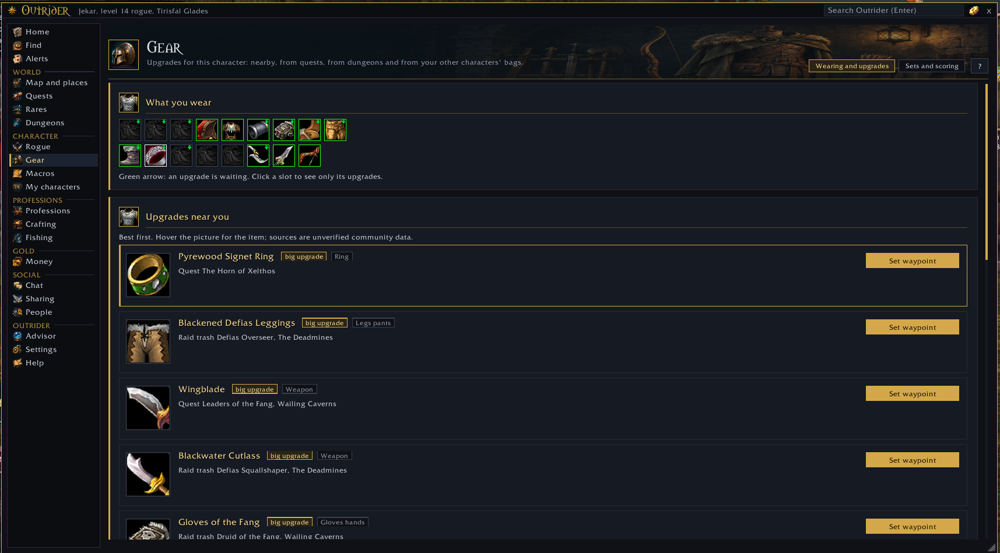</a> <b>Gear</b>: Upgrades for your character and where to get them.</td>
<td width="50%" valign="top"><a href="docs/screenshots/my-characters.png">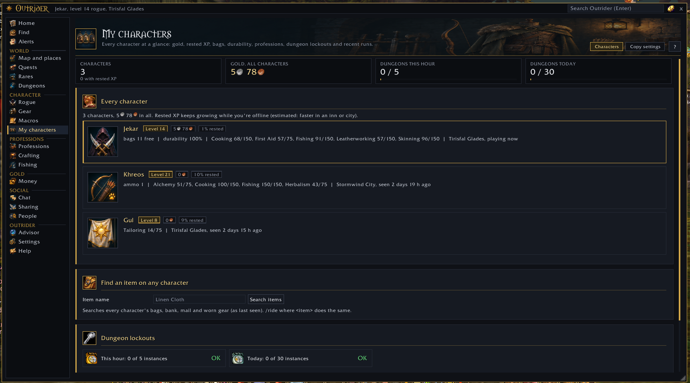</a> <b>My characters</b>: Gold, rested XP, bags, professions and lockouts for every character.</td>
</tr>
<tr>
<td width="50%" valign="top"><a href="docs/screenshots/professions.png">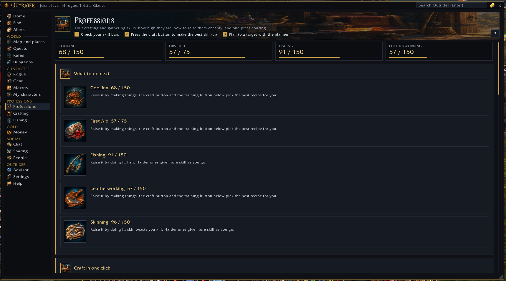</a> <b>Professions</b>: Your skills and what to do next for each.</td>
<td width="50%" valign="top"><a href="docs/screenshots/crafting.png">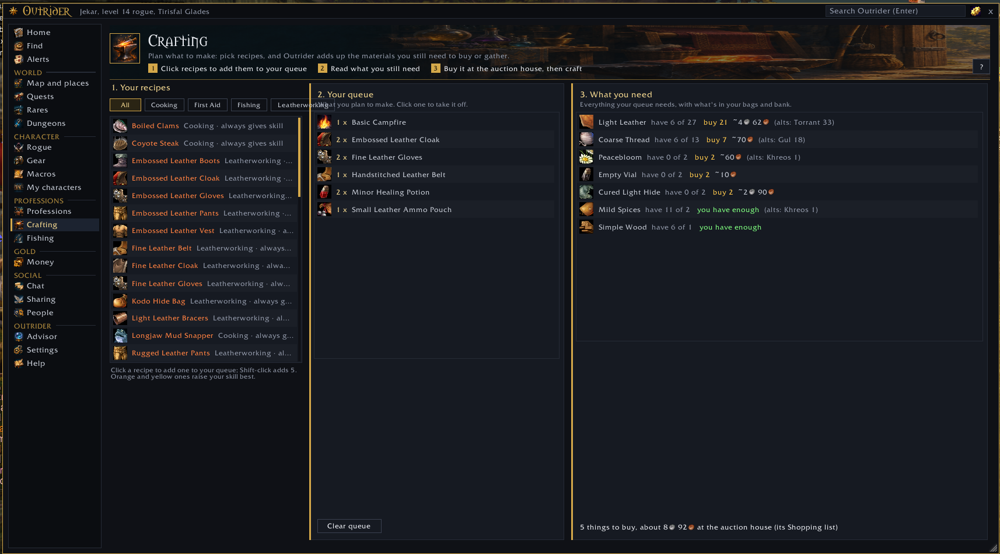</a> <b>Crafting</b>: Pick recipes; Outrider adds up what you still need and what it costs.</td>
</tr>
<tr>
<td width="50%" valign="top"><a href="docs/screenshots/fishing.png">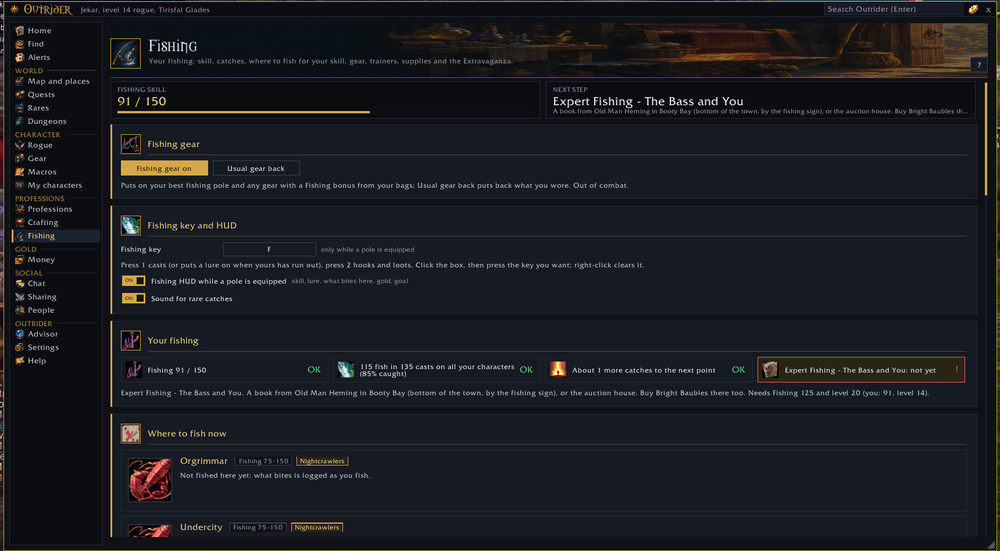</a> <b>Fishing</b>: One-key fishing, your catches, where to fish for your skill and the next book to read.</td>
<td width="50%" valign="top"><a href="docs/screenshots/sharing.png">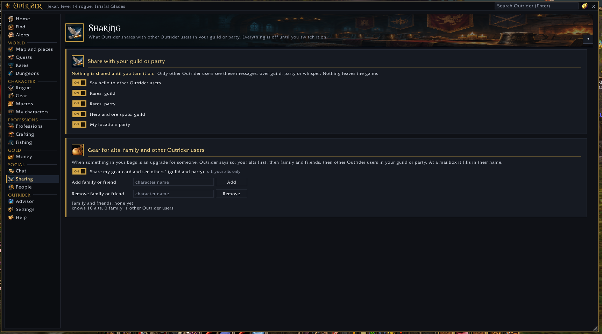</a> <b>Sharing</b>: Everything is off until you switch it on: rares, gathering spots, gear for alts and family.</td>
</tr>
<tr>
<td width="50%" valign="top"><a href="docs/screenshots/help.png">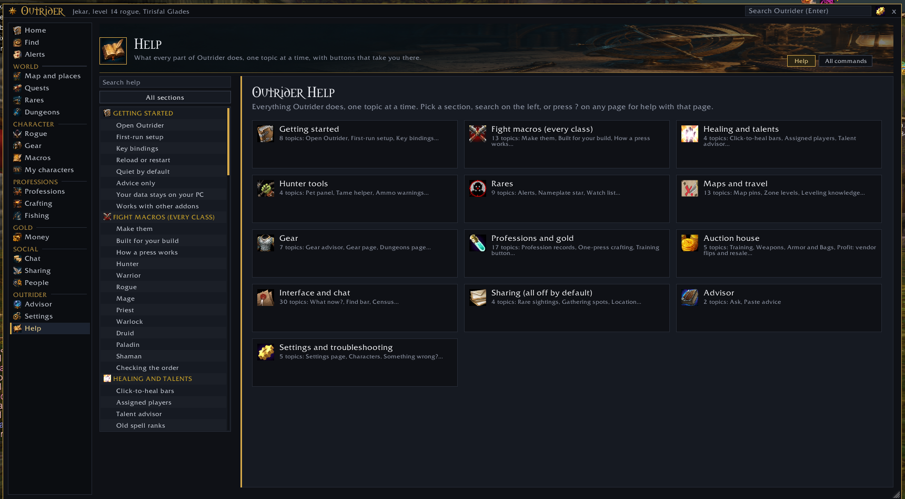</a> <b>Help</b>: Every feature, one topic at a time, with buttons that take you there.</td>
</tr>
</table>

## What it does

Open the hub with `/ride` (or the minimap button). Pages are grouped in the sidebar; Home shows the nearest places, where you're headed, best quests, upgrades, rare watch, errands and your pet.

**Rares and hunters**
- Rare alerts from nameplates, target, mouseover and minimap markers: sound, red screen-edge flash, arrow to the exact spot, Pull/Tame button.
- Watch list, sightings per layer, spawn log at a rare's spot (what spawns there, in what order), rare profiles (level, attack speed, spells).
- Tame macro, pet panel (one-click Feed, diet learned per family, DPS, attack speed, XP), beast attack speed on tooltips, ammo warnings with the nearest ammo vendor.
- Fight macro written from your spellbook and weapon, rewritten out of combat when you learn a spell.

**Maps and travel**
- Waypoints with an arrow, coordinates, quest givers colored by your level, service NPCs, flight paths, rare spawn spots, herb, ore and fishing spots (picked nodes dim for 15 minutes, nodes seen up show green).
- The way there: pick any destination and a line of dots runs from you to it on the world map and minimap, along paths walked before (straight, in paler dots, where nobody walked yet). Quests in another zone plan the trip, zeppelins and skyboats included.
- Finder: search gear, items, quests, rares, creatures, NPCs and places. Journey: best quests anywhere and the quickest route, including flights, boats and portals.

**What now?**
- The next 3 to 5 steps worth doing, picked for your goal (level up, gold, gear, professions, explore, a bit of everything) from your quests, gear, dungeons, training, rares, gold methods, gathering and errands. Each says why and where, with Go, Details, Not useful and an alternative. Unchecked data is labelled.

**Dungeons**
- Dungeons page: which dungeons fit your level now, the upgrades for you in each, the next tier, an arrow to the entrance, and a ready check (repairs, food, bag space, ammo).
- Loot roll advice on the item tooltip: Need, Greed for one of your alts, Greed or Pass. You still click the roll.

**Professions and gold**
- Training button for every crafting profession: one key makes what still gives skill. For cooking it makes the campfire, places it and cooks (never a second campfire).
- Fishing: one key to cast and hook (auto loot), lure applied on the same key, a HUD with skill, lure timer, what bites here, silver per hour, and rare catch sounds.
- Auction house: one panel with **Training** (ingredients and recipes, ranked by cost per skill point), **Weapons** (top 10) and **Armor** (best per slot). Only what your class and skills can use, never above the gold you carry, stat-by-stat comparison and an overall change. Buying is one confirmed click per item. **Scan all prices** gives you prices without other addons.
- Money guide by level, professions and faction, learning your own gold per hour. Gold ledger, merchant panel (sell junk, repair), mailbox collect, inventory across characters.

**Gear**
- Tooltip verdicts weighted for your class, best quest reward, bag upgrades, gear sets, nearby upgrades and where to get them.
- Gear for alts and family: upgrades you loot are offered to your alts first, then family and friends, then other Outrider users, with the mailbox address filled in.

**Interface and sharing**
- Notification feed, chat highlights and spam filter, URL copy, spell check, command bar, errand list, a cleaner skin that steps aside for ElvUI and similar addons.
- Sharing with other Outrider users is **off by default**. When switched on: version hello, rare sightings, gathering spots, gear cards and (separately) your map position, over guild, party, raid or whisper only.

## Safety and privacy

- No automation: every cast, target, buy and craft comes from your key press or click.
- No combat log reading and no protected frame changes in combat.
- Nothing leaves your PC except addon messages for the sharing features you switched on. The updater only asks GitHub for the newest release.

## Data and licence

**Created by Gary Mix.** Copyright (C) 2026 Gary Mix for his original Outrider contributions. The original Outrider project is licensed under **GNU GPLv3-only**: see [LICENSE](LICENSE) and [COPYRIGHT.md](COPYRIGHT.md) for the full license and attribution.

NPC, gear, creature, node, quest and dungeon packs are derived from [QuestieDB](https://github.com/Questie/QuestieDB), whose GPLv3 redistribution permission includes a **documented historical-contributor rights caveat**. The upstream source retains its own copyrights. Follow [our provenance and publication checklist](docs/QUESTIEDB_PUBLICATION_REVIEW_2026-11-18.md), preserve full upstream notices and license terms, and ensure corresponding generated sources are provided. Outrider is not affiliated with Questie. New-in-Forever game data stays marked unverified until checked on WoW Forever.

**Public data packs (2026-11-21):** the six QuestieDB-derived packs are published as source in [outrider-releases/data-packs](https://github.com/LackOfSkillz/outrider-releases/tree/main/data-packs), each with its GPLv3 copy, provenance note and the QuestieDB revision it was built from. Every release zip carries `LICENSE-DATA.txt` and the GPLv3 text inside each data folder.

## Outrider Intelligence 2.0 — engineering design

The proposed next-generation AI coaching edition supports **all nine original classes and their applicable roles**, not just Hunter. It centers on native, offline-capable Opportunity Radar, role-aware gear/quest/profession planning, deterministic vendor-arbitrage analysis, and optional grounded local/cloud model explanations. No automated gameplay or unapproved live external bridge is included.

- **[Complete universal AI engineering blueprint](docs/intelligence/OUTRIDER_INTELLIGENCE_2_0_UNIVERSAL_ENGINEERING_BLUEPRINT.md)**
- **[77-step engineering implementation backlog](docs/intelligence/OUTRIDER_INTELLIGENCE_2_0_IMPLEMENTATION_BACKLOG.md)**
- [Current AI v1 plan](docs/intelligence/OUTRIDER_INTELLIGENCE_ENGINEERING_SPEC.md)

These are **new design documents**, not a claim that Intelligence 2.0 is already implemented or that real-client compatibility has been certified.

## Developers

- `CLAUDE.md`: the rulebook (hard rules, the build, test and deploy loop, commands). Read it first.
- `TASKS.md` and `phases/`: the engineering plan, Phase 0 to 9, with acceptance checks.
- `docs/`: architecture, Forever constraints, probe results, conventions, data formats, the test loop, decisions.
- `addon/Outrider/`: the addon. `addon/Outrider_Data_*` and `private/Outrider_Data_*`: data addons (the private ones are built from a local QuestieDB copy by `tools/import_*.py`).
- `tests/`: about 900 specs that load the addon in a fake WoW client. `tools/test.ps1` runs them.
- `tools/`: deploy, log reader, screenshots, SavedVariables backup, `family.ps1` (one-file installer), `publish.ps1` (GitHub release with the installer), `curseforge.ps1` (CurseForge zip and upload, see [docs/CURSEFORGE.md](docs/CURSEFORGE.md)), `publish_public_packs.py` (data pack sources to the public repo) and `logo.py` (the CurseForge logo).

First-time setup on a new PC: double-click `Setup.cmd` (installs Git, the GitHub CLI, Python with lupa for Lua 5.1 tests, and Claude Code; finds WoW), then run `claude` in this folder and say `Read CLAUDE.md`. Recommended in game for error capture: BugGrabber and BugSack.

In-game commands: `/ride` hub, `/ride help` everything, `/ride status` character and save state, `/ride errors` Outrider errors.
